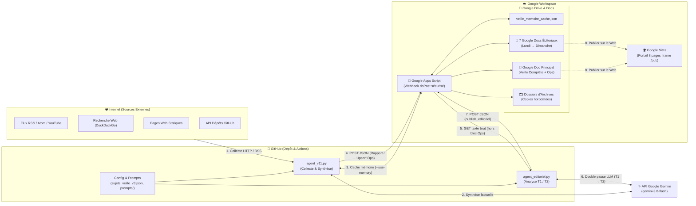
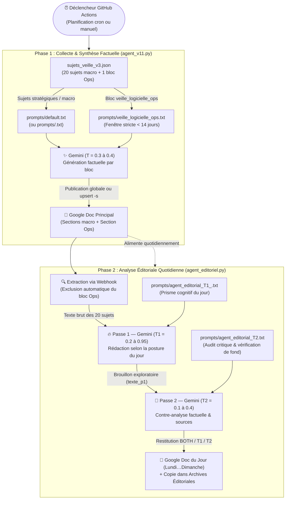

# 📡 Agent de Veille Stratégique, Technologique & Éditoriale Automatisée

Pipeline Python modulaire d'intelligence technologique, opérationnelle, géopolitique et économique piloté par **Gemini (`gemini-3.8-flash`)**, orchestré via **GitHub Actions** et publié automatiquement sur **Google Docs / Google Sites** via un webhook **Google Apps Script**.

---

## 📑 Sommaire

- [🏗️ Architecture du Pipeline](#️-architecture-du-pipeline)
- [📂 Structure du Dépôt](#-structure-du-dépôt)
- [💻 Initialisation de l'Environnement de Développement (PowerShell)](#-initialisation-de-lenvironnement-de-développement-powershell)
- [🧩 Configuration des Sources (`sujets_veille_v3.json`)](#-configuration-des-sources-sujets_veille_v3json)
- [📜 Déploiement et Autorisations Google Apps Script (`Code.gs`)](#-déploiement-et-autorisations-google-apps-script-codegs)
- [📁 Architecture Google Drive et Intégration Google Sites](#-architecture-google-drive-et-intégration-google-sites)
- [🚀 Utilisation en Ligne de Commande](#-utilisation-en-ligne-de-commande)
- [🤖 Automatisation via GitHub Actions et Configuration des Secrets](#-automatisation-via-github-actions-et-configuration-des-secrets)

---

## 🏗️ Architecture du Pipeline

Le système repose sur deux agents autonomes et un backend Google Apps Script communiquant via JSON/UTF-8 :

1. **`agent_v11.py` (Collecte Multi-Sources & Synthèse Factuelle)** :
   * Interroge les blocs thématiques configurés dans `sujets_veille_v3.json` (**RSS/Atom & YouTube XML**, **Flux Google News RSS**, **Recherche Web DuckDuckGo**, **Pages Web statiques**, **Dépôts GitHub**).
   * **Collecte fraîche complète par défaut** : fonctionne sans mémoire persistante afin que chaque rapport hebdomadaire conserve le socle contextuel (`search` et `webpage` actualisés) tout en remontant les dernières publications triées chronologiquement (mémoire Drive dédupliquée activable à la demande via `--use-memory`).
   * **Tri chronologique & Décodage d'URLs** : trie explicitement toutes les entrées RSS du plus récent au plus ancien et décode les liens `news.google.com/rss/articles/...` (Base64/Protobuf) vers l'URL éditeur canonique.
   * **Résilience RSS & anti-WAF** : maintient une session HTTP persistante (`requests.Session` avec amorçage de cookies, sans compression Brotli `br`) et bascule automatiquement sur le flux RSS Google News ciblé (`site:domaine when:14d`) avant tout repli sur la recherche Web en cas de blocage HTTP (`403`, `404`, `503`).
   * Permet soit une **génération complète** (écrasement du rapport principal + archivage horodaté via `makeCopy`), soit une **mise à jour ciblée d'un seul sujet (`--sujet` / `-s`)** directement dans le Google Doc existant.

2. **`agent_editoriel.py` (Analyse Multi-Températures & Prismes Cognitifs)** :
   * Récupère le dernier rapport brut généré par `agent_v11.py` (en excluant automatiquement le bloc purement technique `veille_logicielle_ops`).
   * Applique une architecture à **double passe LLM** :
     * **Passe 1 (`T1` calibrée par posture)** : Lecture transversale et analyse critique selon le prisme éditorial du jour (`LUNDI` à `DIMANCHE`).
     * **Passe 2 (`T2 = 0.1` à `0.4`)** : Relecture, vérification factuelle et mise en forme Markdown avant publication et archivage.

### 1. Schéma d'Architecture Technique Globale



### 2. Schéma du Workflow de Traitement & Chaînage Éditorial



---

## 📂 Structure du Dépôt

```text
.
├── agent_v11.py                        # Agent de collecte multi-sources (mode global ou unitaire)
├── agent_editoriel.py                  # Agent éditorial multi-températures (T1 / T2)
├── Code.gs                             # Backend Webhook Google Apps Script (versionné pour référence)
├── sujets_veille_v3.json               # Configuration des blocs thématiques et de leurs sources
├── requirements.txt                    # Dépendances Python (UTF-8 sans BOM)
├── prompts/                            # Templates de prompts personnalisables
│   ├── default.txt                     # Prompt de synthèse factuelle par défaut
│   ├── veille_logicielle_ops.txt       # Prompt bulletin Ops (fenêtre stricte < 14 jours)
│   ├── <id_sujet>.txt                  # Prompt spécifique optionnel par sujet
│   ├── agent_editorial_T1_<JOUR>.txt   # Prismes cognitifs quotidiens (LUNDI ... DIMANCHE)
│   └── agent_editorial_T2.txt          # Prompt de consolidation et modération
└── .github/workflows/                  # Workflows d'automatisation GitHub Actions
    ├── veille_ops_quotidienne.yml      # Mise à jour quotidienne ciblée (veille_logicielle_ops)
    ├── veille_hebdomadaire.yml         # Génération complète hebdomadaire + archive Drive
    └── veille_editorielle.yml          # Génération des synthèses éditoriales quotidiennes
```

---

## 💻 Initialisation de l'Environnement de Développement (PowerShell)

Ce guide décrit la mise en place complète de l'environnement local sous Windows (PowerShell) pour développer, tester et exécuter l'agent de veille (`agent_v11.py`) et synchroniser le dépôt avec GitHub.

### 1. Installation des prérequis (Python & Git)

Ouvre un terminal **PowerShell** et installe Python 3.12 ainsi que Git via `winget` :

```powershell
# Installer Python 3.12 et Git
winget install -e --id Python.Python.3.12
winget install -e --id Git.Git

# Fermer et rouvrir PowerShell pour recharger le PATH, puis vérifier les versions
python --version
pip --version
git --version
```

> **Note :** Si PowerShell bloque l'activation ultérieure de l'environnement virtuel (`Activate.ps1`), autorise l'exécution des scripts locaux pour ton utilisateur Windows :
> ```powershell
> Set-ExecutionPolicy -ExecutionPolicy RemoteSigned -Scope CurrentUser
> ```

### 2. Récupération ou création du projet et de l'environnement virtuel (`venv`)

Place-toi dans ton répertoire `Documents` (`C:\Users\<utilisateur>\Documents\agent-veille`) :

```powershell
# 1. Se déplacer dans le dossier Documents
cd ~\Documents

# 2a. Si tu clones le dépôt existant depuis GitHub :
git clone https://github.com/<ton-compte>/agent-veille.git
cd agent-veille

# 2b. (Alternative) Si tu pars d'un dossier vierge :
# mkdir agent-veille
# cd agent-veille
# git init

# 3. Créer l'environnement virtuel Python isolé
python -m venv venv

# 4. Activer l'environnement virtuel (le préfixe (venv) apparaît à gauche de l'invite)
.\venv\Scripts\Activate.ps1

# 5. Mettre à jour pip et installer toutes les dépendances depuis requirements.txt
python -m pip install --upgrade pip
pip install -r requirements.txt
```

#### Contenu de `requirements.txt`

> **Important :** Ne pas installer `brotli` ni `brotlicffi` afin de conserver le repli natif `gzip, deflate` de `requests` et éviter les réponses vides sur certains serveurs RSS.

```text
google-genai>=2.33.0
requests>=2.32.0
feedparser>=6.0.11
beautifulsoup4>=4.12.0
ddgs>=9.0.0
```

### 3. Configuration des variables d'environnement permanentes (Utilisateur)

L'agent `agent_v11.py` s'appuie sur 4 variables d'environnement. En les enregistrant au niveau `User` dans le registre Windows, elles restent persistées après redémarrage sans jamais être stockées en clair dans le code source ni poussées sur GitHub.

Exécute ces commandes une seule fois dans PowerShell :

```powershell
# Clé API Google Gemini (obligatoire)
[System.Environment]::SetEnvironmentVariable('GEMINI_API_KEY', 'ta_cle_api_gemini_ici', 'User')

# Token personnel GitHub pour l'API de recherche de dépôts (recommandé pour éviter les rate-limits)
[System.Environment]::SetEnvironmentVariable('GITHUB_TOKEN', 'ton_token_github_pat_ici', 'User')

# URL du déploiement Web App Google Apps Script (obligatoire)
[System.Environment]::SetEnvironmentVariable('WEBHOOK_URL', 'https://script.google.com/macros/s/.../exec', 'User')

# Secret partagé avec Code.gs pour authentifier les requêtes POST (obligatoire)
[System.Environment]::SetEnvironmentVariable('WEBHOOK_SECRET', 'REMPLACER_PAR_UN_SECRET_FORT', 'User')
```

> **Important :** Ferme complètement ta fenêtre PowerShell et rouvre-en une nouvelle pour que Windows charge ces nouvelles variables dans `$env:...`.

#### Vérification des variables chargées dans la session courante

```powershell
# Vérifier que les variables sont bien chargées sans afficher leurs valeurs
@('GEMINI_API_KEY', 'GITHUB_TOKEN', 'WEBHOOK_URL', 'WEBHOOK_SECRET') | ForEach-Object {
    $val = [System.Environment]::GetEnvironmentVariable($_, 'User')
    Write-Host "$_ : $(if ($val) { 'OK (définie)' } else { 'MANQUANTE' })"
}
```

*(Pour surcharger temporairement une variable uniquement pour la session PowerShell en cours sans toucher au registre : `$env:GEMINI_API_KEY="autre_cle"`).*

### 4. Workflow quotidien : reprendre le travail et exécuter l'agent

À chaque nouvelle ouverture de terminal pour travailler sur le projet :

```powershell
# 1. Aller dans le répertoire du projet
cd ~\Documents\agent-veille
pwd

# 2. Réactiver l'environnement virtuel Python
.\venv\Scripts\Activate.ps1

# 3. Récupérer les éventuelles modifications distantes
git pull

# 4. Lancer l'agent en test ciblé sur un seul sujet (rapide, sans mémoire Drive)
python agent_v11.py -c sujets_veille_v3.json -s veille_logicielle_ops

# 5. Ou lancer le rapport complet avec mémoire Drive activée
python agent_v11.py -c sujets_veille_v3.json --use-memory --ttl-days 400
```

### 5. Mémo Git rapide pour publier tes évolutions vers GitHub Actions

```powershell
# Vérifier les fichiers modifiés (s'assurer que venv/ n'est pas suivi via .gitignore)
git status

# Indexer, commiter et pousser sur la branche principale
git add agent_v11.py sujets_veille_v3.json prompts/ .github/
git commit -m "Mise à jour agent_v11 et configuration veille"
git push
```

---

## 🧩 Configuration des Sources (`sujets_veille_v3.json`)

Chaque bloc thématique accepte quatre types de sources, un filtrage optionnel par mots-clés (`keywords`) et un paramètre optionnel `"limit"` (défaut : `3`) :

```json
{
  "id": "veille_logicielle_ops",
  "sujet": "Veille Logicielle, Releases & Incidents Majeurs (Ops)",
  "sources": [
    {
      "type": "rss",
      "url": "https://github.com/haproxy/haproxy/releases.atom",
      "limit": 4
    },
    {
      "type": "search",
      "query": "Ubuntu 24.04 26.04 LTS release notes kernel CVE",
      "limit": 4
    },
    {
      "type": "webpage",
      "url": "https://www.fao.org/worldfoodsituation/csdb",
      "selector": "#mainContent",
      "max_chars": 5000
    },
    {
      "type": "github",
      "query": "kubernetes ingress security",
      "language": "go",
      "limit": 3
    }
  ]
}
```

Vérifier le JSON après édition :

```powershell
python -m json.tool .\sujets_veille_v3.json > $null
Get-Content .\sujets_veille_v3.json -Raw -Encoding UTF8 | ConvertFrom-Json | ConvertTo-Json -Depth 10
```

### Détails techniques de collecte & Isolation Ops

* **Flux `rss` & YouTube** : Supporte les flux RSS 2.0, Atom (dont les `releases.atom` GitHub), les flux natifs YouTube (`youtube.com/feeds/videos.xml?channel_id=...`) et les recherches RSS Google News. Toutes les entrées sont triées par date décroissante avant sélection et les URLs `news.google.com` sont décodées vers leur lien éditeur d'origine.
* **Pages statiques (`webpage`)** :
  * **`url`** *(obligatoire)* : URL directe de la page ou du tableau de bord à surveiller.
  * **`max_chars`** *(optionnel, défaut : `4000`)* : Nombre maximal de caractères extraits après suppression des balises parasites (`<script>`, `<style>`, `<nav>`, `<header>`, `<footer>`, `<aside>`).
  * **`selector`** *(optionnel)* : Sélecteur CSS (`BeautifulSoup.select`) ciblant une zone précise (bascule sur la page complète si introuvable).
* **Bloc opérationnel `veille_logicielle_ops`** : Surveille les versions, CVE et pannes majeures (HAProxy L4, Squid, Envoy Proxy, Ubuntu 24.04/26.04 LTS, Kubernetes RKE2/CCE, Huawei Cloud Stack, Let's Encrypt, hyperscalers) sur une fenêtre glissante stricte de **14 jours**. Placé en fin de configuration, il est automatiquement exclu lors de la lecture du rapport brut par `agent_editoriel.py`.

---

## 📜 Déploiement et Autorisations Google Apps Script (`Code.gs`)

Le script Google Apps Script (`doPost`) expose un point de terminaison sécurisé par `WEBHOOK_SECRET` gérant 6 actions entre Python / GitHub Actions et Google Workspace :

* *(défaut)* : Remplacement complet du rapport brut principal et création instantanée d'une archive horodatée `Veille_YYYYMMDD-HHMMSS` par copie directe (`DriveApp.makeCopy()`).
* `update_single_subject` : Mise à jour chirurgicale (*upsert* `[v7-fallback-clear]`) d'une section `## Titre` unique dans le document principal (insertion séquentielle directe sans décalage de puces et protection contre l'interdiction Google Docs de supprimer l'ultime paragraphe d'une section).
* `get_latest_report` : Extraction du texte brut du rapport principal (avec exclusion automatique du bloc `veille_logicielle_ops`) pour alimenter `agent_editoriel.py`.
* `publish_editoriel` : Mise à jour du Google Doc dédié au jour de la semaine et archivage rapide via `DriveApp.makeCopy()`.
* `get_memory` / `save_memory` : Lecture et écriture en UTF-8 du cache JSON de déduplication sur Google Drive (utilisé uniquement lorsque `--use-memory` est activé).

### 1. Création et configuration du projet Apps Script

1. Rends-toi sur [script.google.com](https://script.google.com) avec le compte Google propriétaire du Google Doc et des dossiers d'archives.
2. Clique sur **Nouveau projet** et renomme-le (par exemple : `Webhook_Agent_Veille`).
3. Colle l'intégralité du code `Code.gs` dans l'éditeur.
4. Vérifie en tête de `doPost(e)` la cohérence des constantes avec ton environnement :
   * `SECRET_KEY` : doit correspondre exactement à la variable `WEBHOOK_SECRET` (PowerShell et Secrets GitHub).
   * `MAIN_DOC_ID`, `MEMORY_FILE_ID`, `ARCHIVE_FOLDER_ID`, `EDITORIEL_ARCHIVE_FOLDER_ID` et `EDITORIEL_DOCS` : identifiants respectifs des fichiers et dossiers cibles sur Google Drive.
5. Enregistre le projet (`Ctrl + S`).

### 2. Amorçage obligatoire des autorisations OAuth (fonctions sans paramètres)

#### Pourquoi cette étape est indispensable ?

La fonction principale `doPost(e)` attend un paramètre HTTP `e` (`e.postData.contents`) : elle ne peut donc pas être exécutée directement depuis l'interface de l'éditeur Apps Script. Or, Google exige une **exécution interactive manuelle** dans l'éditeur pour afficher la fenêtre de consentement OAuth et accorder les permissions (*scopes*) nécessaires à l'accès complet à Google Drive et Google Docs (`drive` et `documents`).

Sans ce déclenchement préalable, tout appel externe depuis Python ou GitHub Actions échouera avec une erreur de permission insuffisante (`Exception: You do not have permission to call ...`).

#### Fonctions d'amorçage à exécuter manuellement

Ajoute ces deux fonctions utilitaires sans paramètres en bas de `Code.gs` afin de forcer Google à demander l'ensemble des droits d'écriture et de déplacement sur Drive et Docs :

```javascript
/**
 * 1. Déclenche l'autorisation de création, déplacement vers un dossier
 *    et mise à la corbeille sur Google Drive (scope Drive complet).
 */
function forceAuthMoveTo() {
  var ARCHIVE_FOLDER_ID = "<ID_DU_DOSSIER_ARCHIVE>";
  var folder = DriveApp.getFolderById(ARCHIVE_FOLDER_ID);

  var tempDoc = DocumentApp.create("temp_test_auth_move");
  tempDoc.saveAndClose();

  var file = DriveApp.getFileById(tempDoc.getId());
  file.moveTo(folder);
  file.setTrashed(true);

  Logger.log("Succès : autorisations Drive (moveTo / setTrashed) accordées.");
}

/**
 * 2. Déclenche l'autorisation de lecture et d'écriture dans un Google Doc
 *    (ouverture par ID, manipulation du Body et sauvegarde).
 */
function forceAuthWriteDoc() {
  var tempDoc = DocumentApp.create("temp_test_auth_write");
  var docId = tempDoc.getId();
  tempDoc.saveAndClose();

  var reopenedDoc = DocumentApp.openById(docId);
  var body = reopenedDoc.getBody();
  body.appendParagraph("Test d'écriture OAuth Apps Script.");
  reopenedDoc.saveAndClose();

  DriveApp.getFileById(docId).setTrashed(true);
  Logger.log("Succès : autorisations Google Docs (openById / write) accordées.");
}
```

#### Procédure d'exécution dans l'éditeur

1. Dans la barre d'outils supérieure de l'éditeur Apps Script, sélectionne **`forceAuthMoveTo`** dans le menu déroulant des fonctions, puis clique sur **Exécuter**.
2. Lors de l'apparition de la fenêtre **Autorisation requise** :
   * Clique sur **Examiner les autorisations** et sélectionne ton compte Google.
   * Sur l'écran d'avertissement *« Google n'a pas validé cette application »*, clique sur **Paramètres avancés** puis sur **Accéder à Webhook_Agent_Veille (non sécurisé)**.
   * Clique sur **Autoriser**.
3. Sélectionne ensuite **`forceAuthWriteDoc`** dans le menu déroulant et clique sur **Exécuter** pour valider les permissions d'édition sur Google Docs.
4. Vérifie dans le **Journal d'exécution** en bas de l'écran que les deux fonctions se terminent avec le statut `Execution completed` sans erreur (les fichiers temporaires créés sont automatiquement envoyés à la corbeille).

### 3. Premier déploiement en tant qu'Application Web (Web App)

Une fois les autorisations accordées, expose le script sous forme d'URL HTTPS publique :

1. En haut à droite de l'éditeur, clique sur **Déployer > Nouveau déploiement**.
2. Clique sur l'icône d'engrenage à côté de *Sélectionner un type* et choisis **Application Web**.
3. Renseigne les paramètres suivants :
   * **Description** : `v1 - Webhook Agent Veille`
   * **Exécuter en tant que** : **Moi** *(indispensable pour que le script utilise tes autorisations Drive/Docs)*
   * **Qui a accès** : **Tout le monde** *(nécessaire pour que les runners GitHub Actions puissent appeler l'URL sans session Google interactive ; la sécurité est assurée par `SECRET_KEY`)*
4. Clique sur **Déployer** et copie l'**URL de l'application Web** (`https://script.google.com/macros/s/.../exec`).
5. Renseigne cette URL dans :
   * Ta variable environnement Windows `WEBHOOK_URL`.
   * Le secret GitHub Actions `WEBHOOK_URL` de ton dépôt (`Settings > Secrets and variables > Actions`).

### 4. Procédure obligatoire lors de toute mise à jour du code `Code.gs`

Dans Google Apps Script, **enregistrer le fichier (`Ctrl + S`) ne met pas à jour l'URL `/exec` en production**. Après chaque modification du code :

1. Enregistre le script (`Ctrl + S`).
2. Clique sur **Déployer > Gérer les déploiements**.
3. Clique sur l'icône **crayon (Modifier)** en haut à droite du déploiement actif.
4. Ouvre la liste déroulante **Version** et sélectionne impérativement **Nouvelle version** *(ne jamais laisser la version existante sélectionnée)*.
5. Clique sur **Déployer** puis sur **OK**.
   * *Avantage :* L'URL `/exec` reste strictement identique — tu n'as pas besoin de modifier `WEBHOOK_URL` dans PowerShell ni dans les Secrets GitHub.

---

## 📁 Architecture Google Drive et Intégration Google Sites

La restitution finale de la veille repose sur **8 documents Google Docs vivants** stockés sur Google Drive (le rapport complet hebdomadaire et les 7 synthèses éditoriales quotidiennes du lundi au dimanche) et exposés dans un portail **Google Sites** privé ou restreint.

### 1. Organisation de l'espace Google Drive

Pour assurer la séparation entre les documents affichés en direct et l'historique horodaté généré par `Code.gs`, structure ton espace Drive avec les éléments suivants :

* **Documents actifs (mis à jour sur place par le Webhook)** :
  1. **Veille complète hebdomadaire** : document principal alimenté par la branche globale / `update_single_subject` (`MAIN_DOC_ID`).
  2. **7 documents éditoriaux quotidiens** (`LUNDI`, `MARDI`, `MERCREDI`, `JEUDI`, `VENDREDI`, `SAMEDI`, `DIMANCHE`) : alimentés chacun à leur tour par la branche `publish_editoriel` (`EDITORIEL_DOCS`).
* **Dossiers d'archives (copie horodatée automatique)** :
  * **Dossier Archives Veille Complète** (`ARCHIVE_FOLDER_ID`) : reçoit les sauvegardes `Veille_AAAAMMJJ-HHMMSS`.
  * **Dossier Archives Éditoriales** (`EDITORIEL_ARCHIVE_FOLDER_ID`) : reçoit les sauvegardes `Editoriel_<JOUR>_AAAAMMJJ-HHMMSS`.
* **Fichier de mémoire persistante** :
  * `veille_memoire_cache.json` (`MEMORY_FILE_ID`) : stocke les empreintes/URLs déjà traitées et leur date d'ingestion (`get_memory` / `save_memory`).

> **Note sur les identifiants :** L'identifiant d'un document ou dossier Drive utilisé dans `Code.gs` correspond à la chaîne alphanumérique située entre `/d/` et `/edit` (ou après `/folders/`) dans son URL d'édition Drive. Cet identifiant **est différent** de l'identifiant public généré lors de la publication sur le Web.

### 2. Publication sur le Web de chacun des 8 Google Docs

Pour qu'un Google Doc puisse être affiché proprement dans une balise `<iframe>` sans les barres d'outils d'édition de Google Docs (et sans blocage `X-Frame-Options`), il doit être publié sur le Web individuellement.

Répète cette opération pour **chacun des 8 documents actifs** (le rapport hebdomadaire + les 7 éditoriaux quotidiens) :

1. Ouvre le Google Doc dans ton navigateur.
2. Dans le menu supérieur, clique sur **Fichier > Partager > Publier sur le Web** *(File > Share > Publish to web)*.
3. Dans l'onglet **Intégrer** *(Embed)* — ou **Lien** — clique sur le bouton bleu **Publier** et confirme dans la boîte de dialogue.
4. Assure-toi dans la section *Contenu publié et paramètres* que la case **Republier automatiquement lorsque des modifications sont apportées** est bien cochée.
5. Copie l'URL générée contenant `/d/e/2PACX-.../pub` :
   ```text
   https://docs.google.com/document/d/e/2PACX-xxxxxxxxxxxxxxxxxxxxxxxxxxxxxxxxxxxx/pub?embedded=true
   ```

> **Point de vigilance :** Chaque document possède sa propre URL publique `/d/e/2PACX-.../pub?embedded=true`. Conserve la correspondance entre chaque document (Hebdomadaire, Lundi à Dimanche) et son URL `/pub?embedded=true` pour l'étape suivante.

### 3. Structuration du portail Google Sites (Accueil + 8 pages intégrées)

#### A. Page d'accueil (`Accueil`)

1. Ouvre [sites.google.com](https://sites.google.com) et crée ou ouvre ton site de veille.
2. Sur la **Page d'accueil**, crée une grille de navigation claire (boutons, cartes ou liens structurés) pointant vers les **8 pages internes** du site :
   * **Veille Stratégique & Technologique Complète** *(rapport hebdomadaire)*
   * **Éditorial — Lundi**
   * **Éditorial — Mardi**
   * **Éditorial — Mercredi**
   * **Éditorial — Jeudi**
   * **Éditorial — Vendredi**
   * **Éditorial — Samedi**
   * **Éditorial — Dimanche**

#### B. Création des 8 pages de type « Code intégré » (*Embed*)

Plutôt que d'utiliser l'insertion native *Google Docs* de Google Sites (qui impose des marges fixes étroites et une hauteur rigide peu lisible sur mobile), chaque page utilise un bloc **Intégrer > Code intégré** (*Embed code*) avec mise à l'échelle adaptative :

* **Sur ordinateur et tablette (`> 600px`)** : élargit la zone de lecture et applique un facteur d'échelle (`scale(1.25)`) pour exploiter la largeur d'écran sans barres de défilement horizontales.
* **Sur mobile (`<= 600px`)** : compense automatiquement les marges internes du rendu Google Docs (`width: 136%; margin-left: -18%`) pour un affichage plein écran lisible.

Pour chacune des **8 pages** :

1. Dans le panneau latéral droit **Pages**, crée la page correspondante (ex. `Veille Hebdomadaire`, `Lundi`, `Mardi`, etc.).
2. Dans l'onglet **Insérer**, clique sur **Intégrer** *(Embed)* puis sélectionne l'onglet **Code intégré** *(Embed code)*.
3. Colle le code HTML/CSS suivant en remplaçant `DOC_ID` par l'identifiant `/d/e/2PACX-...` copié à l'étape 2 :

```html
<style>
  body, html {
    margin: 0;
    padding: 0;
    width: 100%;
    height: 100%;
    overflow-x: hidden;
  }

  /* 1. Ordinateur et Tablette : étale le texte vers la droite */
  iframe {
    width: 78%;
    height: 80vh;
    margin-left: 2%;
    transform: scale(1.25);
    transform-origin: 0 0;
    border: none;
  }

  /* 2. Téléphone uniquement : conserve le cadrage plein écran sans marges superflues */
  @media (max-width: 600px) {
    iframe {
      width: 136%;
      height: 100vh;
      margin-left: -18%;
      transform: none;
    }
  }
</style>
<iframe src="https://docs.google.com/document/d/e/DOC_ID/pub?embedded=true"></iframe>
```

4. Clique sur **Suivant** puis **Insérer**, et étire le cadre du bloc intégré sur toute la largeur de la grille Google Sites (12 colonnes).
5. Une fois les 8 pages configurées et reliées depuis la page d'accueil, clique sur **Publier** en haut à droite de Google Sites pour mettre en ligne le portail.

### 4. Comportement du cache lors des mises à jour automatiques

* **Délai de propagation Drive → Web (`/pub`)** : lorsqu'un script Apps Script (`DocumentApp`) met à jour un Google Doc, la version publiée sur le Web (`/pub?embedded=true`) est mise en cache par les serveurs Google pendant **5 à 15 minutes** avant d'afficher automatiquement le nouveau contenu.
* **Forcer l'affichage immédiat** : pour vérifier immédiatement une mise à jour dans Google Docs ou Google Sites sans attendre l'expiration du cache Service Worker / serveur, recharge la page du navigateur avec **`Ctrl + Shift + R`** ou ajoute un paramètre factice à l'URL du site (ex. `?refresh=1`).

---

## 🚀 Utilisation en Ligne de Commande

### 1. Collecte et synthèse (`agent_v11.py`)

**Exécution complète (tous les sujets + archive horodatée) :**

```bash
python agent_v11.py \
  --temperature 0.4 \
  --use-memory \
  --ttl-days 400 \
  --retry-delay 120 \
  --max-retries 3 \
  --web-retries 5 \
  --web-retry-delay 61 \
  -c sujets_veille_v3.json
```

**Mise à jour ciblée d'un seul sujet (`--sujet` / `-s`) :**

```bash
python agent_v11.py \
  --temperature 0.3 \
  --ttl-days 400 \
  --retry-delay 120 \
  --max-retries 3 \
  --web-retries 5 \
  --web-retry-delay 61 \
  -c sujets_veille_v3.json \
  -s veille_logicielle_ops
```

> *En mode unitaire, seul le bloc ciblé est collecté et généré. Le webhook Apps Script (`update_single_subject`) remplace uniquement la section `## <Titre du sujet>` correspondante dans le Google Doc principal (ou l'ajoute à la fin s'il s'agit d'un nouveau sujet) sans écraser le reste du document.*

| Option | Défaut | Rôle |
| --- | --- | --- |
| `-c`, `--config` | `sujets_veille.json` | Fichier JSON de configuration des sujets |
| `-s`, `--sujet` | `None` | Traite et met à jour uniquement le sujet ciblé (par son `id` ou son libellé exact `sujet`) |
| `-t`, `--temperature` | `0.4` | Température de génération Gemini (`max_output_tokens=8192`) |
| `--use-memory` | `False` | Active le filtrage par mémoire persistante Google Drive (désactivé par défaut) |
| `-n`, `--no-memory` | `False` | Désactive explicitement la mémoire Drive (conservé pour compatibilité ascendante) |
| `--ttl-days` | `30` | Durée de rétention (jours) des entrées en mémoire Drive si `--use-memory` est actif |
| `-r`, `--retry-delay` | `60` | Pause (s) avant nouvelle tentative globale sur un sujet vide |
| `-m`, `--max-retries` | `2` | Nombre max de tentatives globales par sujet |
| `--web-retries` | `2` | Nombre max de tentatives locales par requête DuckDuckGo |
| `--web-retry-delay` | `5` | Délai de base (s) avant retry local DuckDuckGo |

### 2. Synthèse éditoriale (`agent_editoriel.py`)

```bash
python agent_editoriel.py \
  --jour LUNDI \
  --subject "VEILLE TECH & STRATÉGIE" \
  --temp1 0.4 \
  --temp2 0.1 \
  --output-mode BOTH
```

| Option | Défaut | Rôle |
| --- | --- | --- |
| `-j`, `--jour` | `LUNDI` | Sélectionne `prompts/agent_editorial_T1_<JOUR>.txt` et le Google Doc cible |
| `-s`, `--subject` | `""` | Intitulé ajouté au titre principal de l'éditorial |
| `-t1`, `--temp1` | `0.9` | Température de la Passe 1 (exploration / prisme cognitif) |
| `-t2`, `--temp2` | `0.1` | Température de la Passe 2 (modération / sobriété) |
| `-o`, `--output-mode` | `BOTH` | Contenu publié (`BOTH`, `T1` ou `T2`) |

#### Matrice des 7 Prismes Éditoriaux Quotidiens

| Jour | Prisme Cognitif | Horizon | $T_1$ Recommandée |
| --- | --- | --- | --- |
| **LUNDI** | **Pessimiste** (Risques systémiques & effets domino) | Court terme (2–3 ans) | `0.40` |
| **MARDI** | **Perspective** (Psychohistoire façon *Fondation* d'Asimov & audit des angles morts) | Long terme (2030 / 2050) | `0.65` |
| **MERCREDI** | **Philosophe désabusé** (Cynisme clinique Houellebecq / Schopenhauer) | Intemporel / Sociétal | `0.95` |
| **JEUDI** | **Auteur SF** (Hard SF spéculative incarnée) | 2050 (Narratif) | `0.80` |
| **VENDREDI** | **Humoriste** (Satire politique acide Desproges / Caverivière) | Présent décalé | `0.90` |
| **SAMEDI** | **Optimiste** (Stoïcisme & leviers d'adaptation tangibles sans utopie) | Moyen terme | `0.35` |
| **DIMANCHE** | **Synthèse neutre** (Briefing exécutif factuel en 400 mots) | Présent immédiat | `0.20` |

---

## 🤖 Automatisation via GitHub Actions et Configuration des Secrets

L'orchestration quotidienne et hebdomadaire du pipeline repose sur **GitHub Actions**, qui exécute `agent_v11.py` et `agent_editoriel.py` dans un conteneur Ubuntu éphémère sans nécessiter de serveur dédié allumé en permanence.

### 1. Configuration des Secrets du dépôt (`Actions secrets`)

Les clés d'API et URLs sensibles ne doivent jamais figurer en clair dans les fichiers YAML ou Python. Elles sont injectées au moment de l'exécution sous forme de variables d'environnement via les **Secrets** du dépôt.

1. Ouvre ton dépôt sur **GitHub**, puis va dans **Settings > Secrets and variables > Actions**.
2. Dans l'onglet **Secrets** (*Repository secrets*), clique sur **New repository secret** et crée les entrées suivantes :

| Nom du Secret | Rôle dans le pipeline | Exemple / Format attendu |
| --- | --- | --- |
| **`GEMINI_API_KEY`** | Authentification auprès de l'API Google Gemini (`gemini-3.8-flash`). | `AIzaSy...` |
| **`WEBHOOK_URL`** | URL publique `/exec` du déploiement Web App Google Apps Script. | `https://script.google.com/macros/s/.../exec` |
| **`WEBHOOK_SECRET`** | Jeton partagé vérifié par `doPost(e)` dans `Code.gs` (`SECRET_KEY`). | `REMPLACER_PAR_UN_SECRET_FORT` |
| **`GITHUB_TOKEN`** *(automatique)* | Fourni automatiquement par GitHub Actions pour l'API GitHub (ou PAT personnalisé si besoin de quotas étendus). | `${{ secrets.GITHUB_TOKEN }}` |

### 2. Définition des workflows YAML (`.github/workflows/`)

#### A. Workflow de veille quotidienne ciblée (`veille_ops_quotidienne.yml`)

Met à jour quotidiennement la section technique (`-s veille_logicielle_ops`) sans réécrire l'ensemble du document, et permet également un déclenchement manuel sur n'importe quel `id` de sujet depuis l'interface GitHub (*Run workflow*).

```yaml
name: Veille Quotidienne & Ciblée (Ops)

on:
  schedule:
    # Exécution automatique tous les jours à 06h30 UTC (07h30 heure de Paris en hiver / 08h30 en été)
    - cron: '30 6 * * *'
  workflow_dispatch:
    inputs:
      sujet_id:
        description: "ID du sujet à mettre à jour (ex: veille_logicielle_ops, ia_agentique)"
        required: true
        default: 'veille_logicielle_ops'
        type: string
      use_memory:
        description: "Activer la mémoire Drive (--use-memory)"
        required: false
        default: false
        type: boolean

jobs:
  run-veille-ciblee:
    runs-on: ubuntu-latest
    timeout-minutes: 25

    steps:
      - name: Récupérer le code du dépôt
        uses: actions/checkout@v4

      - name: Configurer Python 3.11
        uses: actions/setup-python@v5
        with:
          python-version: '3.11'
          cache: 'pip'

      - name: Installer les dépendances Python
        run: |
          python -m pip install --upgrade pip
          pip install -r requirements.txt

      - name: Exécuter agent_v11.py sur le sujet cible
        env:
          GEMINI_API_KEY: ${{ secrets.GEMINI_API_KEY }}
          WEBHOOK_URL: ${{ secrets.WEBHOOK_URL }}
          WEBHOOK_SECRET: ${{ secrets.WEBHOOK_SECRET }}
          GITHUB_TOKEN: ${{ secrets.GITHUB_TOKEN }}
        run: |
          SUJET="${{ github.event.inputs.sujet_id || 'veille_logicielle_ops' }}"
          MEM_FLAG=""
          if [ "${{ github.event.inputs.use_memory }}" == "true" ]; then
            MEM_FLAG="--use-memory"
          fi
          python agent_v11.py \
            --temperature 0.3 \
            --ttl-days 400 \
            --retry-delay 120 \
            --max-retries 3 \
            --web-retries 5 \
            --web-retry-delay 61 \
            -c sujets_veille_v3.json \
            -s "$SUJET" \
            $MEM_FLAG
```

#### B. Workflow du rapport complet hebdomadaire (`veille_hebdomadaire.yml`)

Régénère l'intégralité des sujets de `sujets_veille_v3.json`, remplace le contenu complet du Google Doc principal et crée une archive horodatée dans Google Drive (`Veille_AAAAMMJJ-HHMMSS`).

```yaml
name: Veille Complète Hebdomadaire

on:
  schedule:
    # Exécution automatique tous les dimanches à 05h00 UTC
    - cron: '0 5 * * 0'
  workflow_dispatch:

jobs:
  run-veille-complete:
    runs-on: ubuntu-latest
    timeout-minutes: 45

    steps:
      - name: Récupérer le code du dépôt
        uses: actions/checkout@v4

      - name: Configurer Python 3.11
        uses: actions/setup-python@v5
        with:
          python-version: '3.11'
          cache: 'pip'

      - name: Installer les dépendances Python
        run: |
          python -m pip install --upgrade pip
          pip install -r requirements.txt

      - name: Exécuter la collecte et publication complète
        env:
          GEMINI_API_KEY: ${{ secrets.GEMINI_API_KEY }}
          WEBHOOK_URL: ${{ secrets.WEBHOOK_URL }}
          WEBHOOK_SECRET: ${{ secrets.WEBHOOK_SECRET }}
          GITHUB_TOKEN: ${{ secrets.GITHUB_TOKEN }}
        run: |
          python agent_v11.py \
            --temperature 0.4 \
            --use-memory \
            --ttl-days 400 \
            --retry-delay 120 \
            --max-retries 3 \
            --web-retries 5 \
            --web-retry-delay 61 \
            -c sujets_veille_v3.json
```

#### C. Workflow de publication éditoriale quotidienne (`veille_editorielle.yml`)

Génère et publie l'éditorial du jour à partir du dernier rapport brut en appliquant la posture cognitive associée au jour de la semaine.

```yaml
name: Publication Éditoriale Quotidienne

on:
  schedule:
    # Exécution automatique tous les jours à 07h00 UTC
    - cron: '0 7 * * *'
  workflow_dispatch:
    inputs:
      jour:
        description: "Jour cible (LUNDI à DIMANCHE)"
        required: true
        default: 'LUNDI'
        type: choice
        options:
          - LUNDI
          - MARDI
          - MERCREDI
          - JEUDI
          - VENDREDI
          - SAMEDI
          - DIMANCHE

jobs:
  run-editoriel:
    runs-on: ubuntu-latest
    timeout-minutes: 15

    steps:
      - name: Récupérer le code du dépôt
        uses: actions/checkout@v4

      - name: Configurer Python 3.11
        uses: actions/setup-python@v5
        with:
          python-version: '3.11'
          cache: 'pip'

      - name: Installer les dépendances Python
        run: |
          python -m pip install --upgrade pip
          pip install -r requirements.txt

      - name: Déterminer le jour et exécuter agent_editoriel.py
        env:
          GEMINI_API_KEY: ${{ secrets.GEMINI_API_KEY }}
          WEBHOOK_URL: ${{ secrets.WEBHOOK_URL }}
          WEBHOOK_SECRET: ${{ secrets.WEBHOOK_SECRET }}
        run: |
          if [ -n "${{ github.event.inputs.jour }}" ]; then
            JOUR="${{ github.event.inputs.jour }}"
          else
            JOURS=(DIMANCHE LUNDI MARDI MERCREDI JEUDI VENDREDI SAMEDI)
            JOUR=${JOURS[$(TZ="Europe/Paris" date +%w)]}
          fi
          python agent_editoriel.py \
            --jour "$JOUR" \
            --subject "VEILLE TECH & STRATÉGIE" \
            --output-mode BOTH
```

### 3. Bonnes pratiques d'exploitation et diagnostic

* **Fuseau horaire des planifications (`cron`)** : GitHub Actions interprète toujours les expressions `cron` en **UTC** (soit `-1h` par rapport à l'heure d'hiver en France et `-2h` par rapport à l'heure d'été). Un léger décalage de 5 à 15 minutes au démarrage est normal lors des pics de charge des runners GitHub.
* **Déclenchement manuel à la demande** : dans l'onglet **Actions** de ton dépôt GitHub, sélectionne le workflow souhaité dans le menu de gauche, clique sur **Run workflow**, saisis éventuellement l'`id` d'un sujet spécifique (par exemple `ia_agentique` ou `veille_logicielle_ops`), puis valide.
* **Lecture des bilans et erreurs** : chaque exécution affiche en fin de console le **Bilan chiffré de la collecte** (entrées RSS, fallbacks Google News, pages Web, dépôts GitHub) ainsi que le message de retour du Webhook Apps Script (`[v7-fallback-clear] Sujet '...' mis à jour sur place.`). En cas d'échec HTTP ou de clé manquante, le script retourne un code de sortie non nul (`sys.exit(1)`), marquant immédiatement le job en rouge dans GitHub Actions.